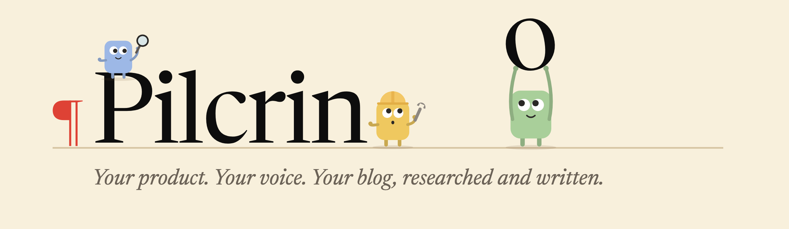
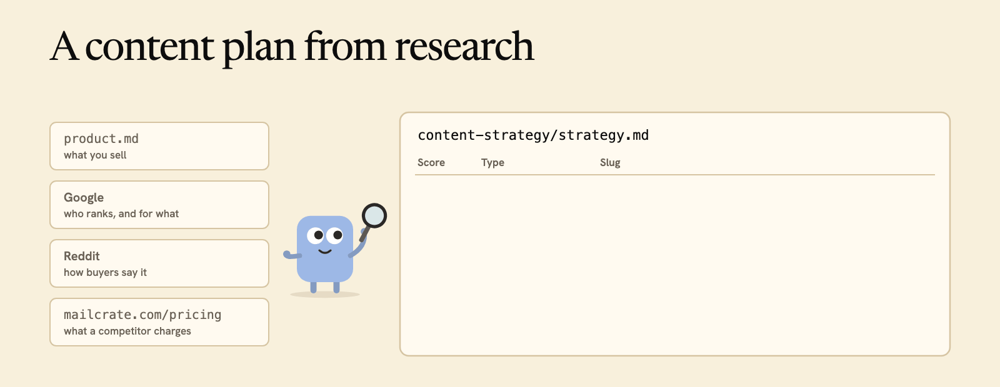
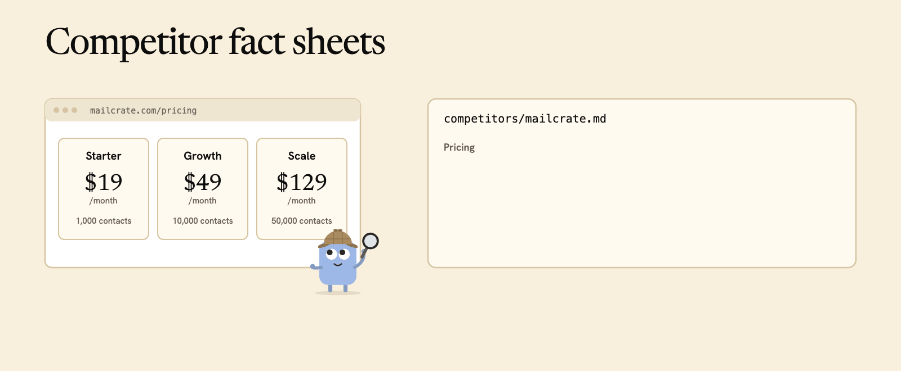
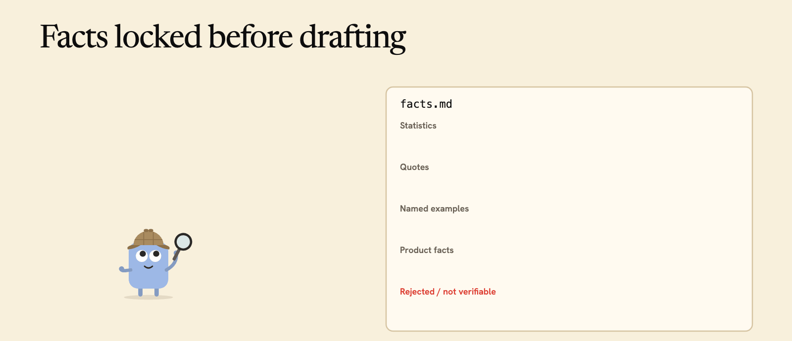
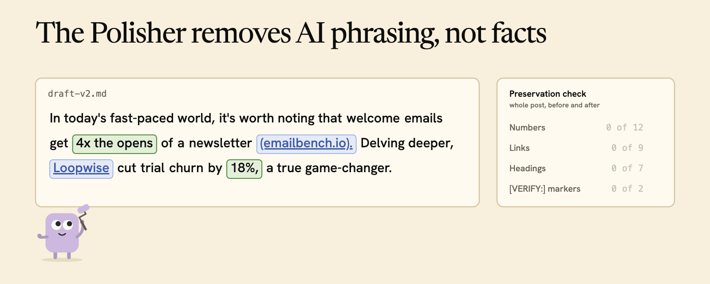
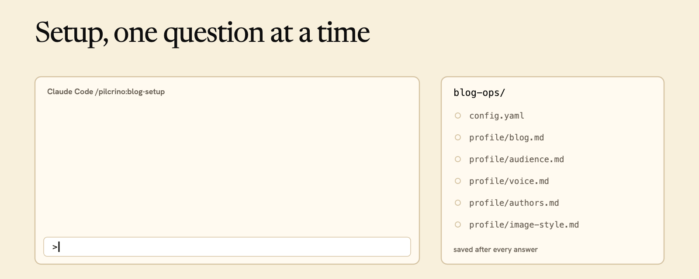
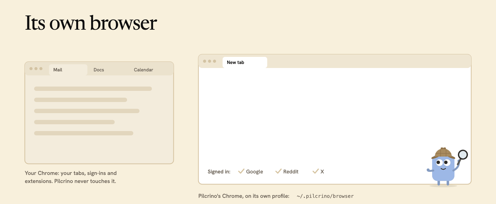
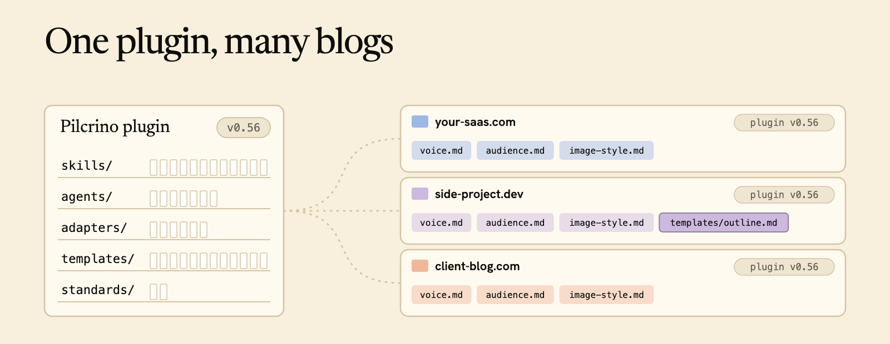
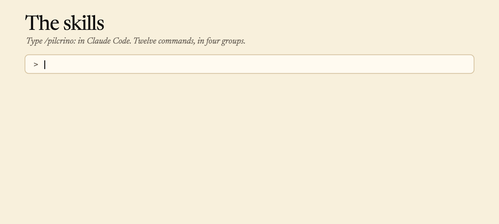

<p align="center">
  
</p>

# Pilcrino

[](https://github.com/pilcrino/pilcrino/tags)
[](LICENSE)

Blog posts for your product's blog, written inside Claude Code.

- **A researched content plan.** It reads Google and your competitors, plus
  Reddit and X if you turn them on, then ranks the posts your buyers are
  looking for.
- **Research first, with sources.** Google, plus Reddit and X if you turn
  them on, read in its own signed-in browser. Every post targets one query
  and answers it within the first forty words, the shape AI assistants quote.
- **Competitor fact sheets.** It reads each competitor's pricing and
  features and dates the sheet. It offers to read a sheet older than 14 days
  again before a post uses it, and the reviewer checks competitor prices in
  the draft against it.
- **Facts locked before drafting.** The writer may only cite what is in the
  facts file; anything else is flagged for you.
- **A separate reviewer.** It sends weak drafts back: on my blogs, 64 of 88
  first drafts.
- **A final polish.** It removes AI phrasing and keeps every number, link
  and citation intact.
- **Images in your style.** Drawn images use your blog's colours and fonts
  and show your own product, no stock art. AI illustrations and screenshots
  are optional.
- **Published as a pull request.** You read it and approve it. It never
  merges on its own.


**Install**, in Claude Code:

```text
/plugin marketplace add pilcrino/pilcrino
/plugin install pilcrino@pilcrino
```

A new computer needs Chrome, Node and the GitHub CLI first: [What you need](#what-you-need)
and [Install](#install) walk through it. Then run `/pilcrino:blog-setup`
(see [Quickstart](#quickstart)).

Pilcrino writes how-to guides, best-of lists, "alternatives to" posts and
comparisons of your product with its competitors. It works with sites built
from a GitHub repository (Astro, Hugo, Next.js, Eleventy and other markdown
sites), creates drafts in WordPress, and hands you a file to paste in for
Webflow, Ghost, Jekyll and other platforms. Research and writing run on your
Claude plan in a long Claude Code session.

## What it does

Seven subagents do the work, each with one job. This is what each one reads
and what it writes.


### A content plan from research

`/pilcrino:plan-content` turns your product into a list of posts worth
writing. It reads your product description, searches Google for the queries
your buyers run, reads Reddit and X (when you turn them on) for how they
describe the problem, and scans your competitors' sites. Every post gets a
target query, a page type (how-to, best-for, alternatives, vs, review and
others), an angle and a score out of 10: customer impact 30%, product fit
25%, buying intent 25%, ease 20%.

The first run plans 30 posts grouped into pillars; later runs add 15 more
without repeating any, and `/pilcrino:plan-content "<idea>"` turns one idea
of yours into 3 to 8. A comparison post whose competitor has no fact sheet
yet is marked to research that competitor first. The posts land in
`blog-ops/content-plan.md`, and the scores, pillars and findings in
`blog-ops/content-strategy/strategy.md`, in about 30 minutes, with no
questions asked while it runs.



### Competitor fact sheets

`/pilcrino:research-competitor <name>` reads a competitor's site in the
Pilcrino browser, never with a plain fetch, because pricing pages render
with JavaScript and hide tiers behind toggles. The fact sheet records every
public tier (monthly and annual price, what it is capped on, promotional
versus renewal pricing), key claims quoted word for word, a table comparing
the competitor with your product, every page it read, and a "Last verified"
date.

A post that names a competitor reads its sheet. When the sheet is missing or
older than 14 days, Pilcrino offers to read the site again first, about 2.5
minutes per competitor. The writer may cite competitor prices only from a
fresh sheet, and the reviewer checks them. This needs the Competitors
module, turned on in setup.



### Facts locked before drafting

Before a word of the draft is written, the editor builds `facts.md` from the
research and your product file. Every statistic, quote and named example
carries its source URL, product facts point at your own files, and competitor
facts carry their sheet's "Last verified" date. Claims that cannot be
verified go under "Rejected / not verifiable" with the reason, so they never
reach the post.

The writer may cite only what is in this file. Anything else it wants to say
is marked `[VERIFY:]` for you to check, and the reviewer checks the draft
against the file.



### The Polisher removes AI phrasing, not facts

After the reviewer approves, the Polisher changes how the post sounds and
nothing it says. It runs seven passes: AI phrases (the shared list plus your
own from `voice.md`), em dashes, passive voice, third-person drift, sentence
rhythm in every section, your voice, and a last grammar read.

It must keep every number, link, heading, FAQ question, frontmatter value and
`[VERIFY:]` marker. Before it starts it saves a copy and lists them; after,
it checks the list again, and if anything is missing or changed it restores
the copy and tells you.



### Images in your style

Setup turns your answers about palette, fonts, mood and watermark into
`image-style.md` and, for drawn images, a Remotion project with a `theme.ts`.
For each post the Image planner writes `images.md`: a cover and one entry per
image slot in the draft, each with its type, concept, filename and alt text.

The Image builder renders them. Drawn images come from `theme.ts`, so every
colour, font and the watermark come from one file. AI illustrations through
`codex` are optional, and screenshots of other sites stay a short to-do for
you. The cover carries the post title word for word, and your product's own
screens are recreated as mockups rather than captured, so nothing from a real
account leaks.


## What you need

It runs on macOS, Windows 10 or 11 (x64) and Linux (Debian, Ubuntu and
Fedora are the ones with install commands in setup; a desktop session is
needed for the browser). Pilcrino does not host or deploy your blog; it
only adds posts to it. Every blog needs a GitHub repository, because every
post is reviewed as a pull request. A site that is not live yet is fine.

Software, installed once:

- Google Chrome.
- Claude Code, signed in to a Claude plan that includes it. On Windows,
  Claude Code runs in Windows Terminal with Git for Windows installed
  (Pilcrino's steps run in its bash), not in PowerShell alone.
- `git`: Apple's Command Line Tools on a Mac, Git for Windows on Windows,
  the `git` package on Linux.
- Node 22.13 or newer; 24 is fine. On Windows the x64 build, also on an Arm
  PC (the drawn-images renderer has no Windows on Arm build).
- GitHub CLI (`gh`), signed in to your GitHub account.
- `jq`, only for a WordPress blog.

Setup checks all of these on its first run and gives the one install route
for your system for anything missing.

Accounts:

- GitHub, for the repository your posts go into.
- Google, for research. Pilcrino searches signed in.
- Reddit and X, only if you turn those research sources on in setup.
- WordPress: an application password (in WordPress admin, Users, Profile,
  Application Passwords). Pilcrino creates drafts with it and never publishes.
  Setup asks for it once through a hidden prompt and stores it in your
  Mac's keychain, or in your user settings on Windows, or in your shell's
  settings file on Linux; it never goes into the repository or the chat.
  On a Mac an environment variable is offered as the alternative.
- LinkedIn, only for `post-to-linkedin`: you must be an admin of the company
  page.

## Install

The steps below are for a Mac. On Windows: install Git for Windows
(https://git-scm.com/download/win, defaults), then in Windows Terminal run
`winget install OpenJS.NodeJS.LTS --architecture x64 GitHub.cli Google.Chrome`,
open a new window, and continue from step 4. On Linux: install `git`,
Node 22 (https://nodejs.org or your distribution's package), the GitHub CLI
(https://github.com/cli/cli/blob/trunk/docs/install_linux.md) and Google
Chrome (the `.deb` or `.rpm` from https://www.google.com/chrome; the snap
Chromium does not work, because snaps cannot read the hidden folder the
Pilcrino browser keeps its profile in), then continue from step 4. Setup
also checks all of this and offers the missing pieces.

Open Terminal (in Spotlight, type Terminal). On a Mac that has never had
developer tools, the very first command below may open an Apple dialog
offering to install them: click Install, wait for it to finish, then run the
command again.

1. Command Line Tools. Type `git --version`. If a dialog appears, that is the
   installer: click Install. (Terminal may also print a note about
   `xcode-select`; that is normal and needs no action.) When
   `git --version` prints a version, you are done.
2. Homebrew (the installer for the next two). Paste the one-line command from
   https://brew.sh and follow its prompts: it asks for your Mac password
   (nothing shows as you type; press Return when done) and then asks you to
   press Return to continue. When it ends with "Next steps", run the two or
   three commands it prints: they add Homebrew to your PATH, and without them
   the next window will say `command not found: brew`. Check:
   `brew --version`.
3. Node and the GitHub CLI: `brew install node@22 gh`. Answer `y` if it asks
   a yes or no question. Check: `node --version` prints v22.13 or newer (24
   is fine too), `gh --version` prints a version. If `node --version` says
   "command not found", run `brew link --overwrite node@22` and check again.
4. Sign the GitHub CLI in: `gh auth login`, press Enter on every question to
   take the defaults, and finish the sign-in in the browser window it opens
   (your Mac's default browser, usually Safari). Check: `gh auth status`
   says "Logged in".

Then, in Claude Code:

5. Run `claude` in Terminal (Windows Terminal on Windows). Which folder you are in does not matter yet
   (it will after setup, see Quickstart). At the safety question, choose
   "Yes, I trust this folder"; the highlighted default exits.
6. Type these two commands into Claude Code's prompt, one at a time (they are
   Claude Code commands, not Terminal commands):

   ```text
   /plugin marketplace add pilcrino/pilcrino
   /plugin install pilcrino@pilcrino
   ```

   The install screen asks for a scope; the default, "Install for you", is
   right.
7. Check: type `/plugin`. It opens on the Discover tab; press Tab to reach
   Installed, which lists `pilcrino` with 12 skills and a `pilcrino-browser`
   server, Tab again for Errors, which should be empty, and Esc to close.

Pilcrino works best in Claude Code's auto mode (Shift+Tab switches modes).
When Claude Code still asks whether it may read or write one of Pilcrino's own
files, "Yes, and don't ask again" is safe.

## Quickstart



1. **Start Claude Code and run `/pilcrino:blog-setup`.** Start it in your
   site's folder if the site is on this computer; otherwise anywhere. Setup
   first checks the computer (git, Node, the GitHub tool and its sign-in,
   Chrome) and offers to install what is missing, with the route for your
   system (Mac, Windows or Linux). Then it asks where the blog is: a folder
   on this computer, a repository on GitHub (it downloads
   it), or nowhere yet (it creates a GitHub repository with your consent). A
   WordPress, Webflow or other blog that is not built from a repository still
   gets a GitHub repository, because every post is reviewed as a pull request
   and the repository keeps the post files. After setup, start Claude Code
   in the blog's folder (`cd <blog folder>` then `claude`) for every later
   command, because the skills read `blog-ops/config.yaml` from the folder
   you start in.
2. **Answer the questions.** Quick setup asks about ten, each with the
   recommended answer as the first choice, and takes the rest from your
   site and repository; detailed setup asks every question. Everything it
   derived is shown to you before it is saved. Setup saves as it goes, so
   you can stop and run it again later to continue. It reads your site
   (which fields your posts can carry, whether there is a draft switch,
   how the site goes live) and asks before changing anything in it. It
   opens the sign-in window for the Pilcrino browser once (see below).
   Setup writes a `blog-ops/` folder
   in your repository (plus a `tools/remotion/` image project when you turn
   on drawn images) and, at the end, asks before committing and pushing
   those files to your main branch; every post needs them there.
3. **Plan what to write:** `/pilcrino:plan-content`. It researches your
   product, its competitors and what people search for, and writes a list of
   posts to `blog-ops/content-plan.md`. About 30 minutes, no questions asked
   while it runs. For a blog not registered with the Pilcrino app,
   comparison posts about competitors that have no fact sheet yet are in the
   plan too, marked to research the competitor first; for a registered blog
   they wait until the competitor is researched, and the report says how to
   add it.
4. **Write a post:** `/pilcrino:blog-post-workflow new`. A few questions at the
   start, then about 40 minutes of work ending in a pull request. Best-of,
   alternatives and comparison posts need a research profile for every
   competitor they name, no older than 14 days; Pilcrino writes one when you
   ask (`/pilcrino:research-competitor <name>`, about 2.5 minutes each) and
   tells you which posts need them; when you start such a post, Pilcrino offers to
   research the missing fact sheets right there.

You can also just say what you want ("Can you make me a content plan?",
"Write a how-to about ...") and Claude Code picks the right skill.

Every blog needs a GitHub repository, because every post is reviewed as a
pull request. A site built from that repository publishes when the pull
request merges; on WordPress you publish the draft in WordPress admin. On a
paste platform you put the post file Pilcrino hands you into the platform,
check it there and then say "approve"; merging files the repository copy. A site that
is not live yet is fine: you read the post in the
pull request (or in its preview, if your site builds one for every pull
request).

## Reviewing and publishing a post


Every post ends as a pull request on GitHub (a WordPress post also appears as
a draft in WordPress admin, with a preview link). Read it there. To ask for
changes, tell Pilcrino in Claude Code. By default Pilcrino does not read
comments on GitHub. Set `review.pr_monitor: true` in `blog-ops/config.yaml`
(setup asks on the detailed path) and, while Claude Code stays open, a
watcher checks the pull request every 15 minutes (less often when nothing
happens), makes the changes asked for in comments and replies.

When the post is right, approve it: if you work alone, tell Pilcrino
"approve" in Claude Code. With the watcher off, merging the pull request
yourself also counts as approval, and Pilcrino finishes the post the next
time you resume it. With the watcher on, an approval on GitHub is recorded
too. Approving
does not publish. Publishing is your action:

- a site built from the repository (Astro, Hugo, Next.js, Eleventy): merge the
  pull request;
- WordPress: click Publish in WordPress admin;
- Webflow, Ghost, Jekyll and other paste platforms: Pilcrino hands you the
  post as a markdown file with its images before you approve. Put it in,
  check it there, say "approve", then merge the pull request so the
  repository keeps it.

To merge, open the pull request on GitHub, click the green "Merge pull
request" button, then "Confirm merge". Or, after approving the post in Claude
Code, tell Pilcrino "merge it" there and it merges for you. It first checks that the
pull request has no conflicts, that GitHub's checks have passed, and that
nothing changed since you approved; if something is wrong it says what and
merges nothing. Pilcrino only merges when you ask it in Claude Code: never on
its own, and never because of a comment on GitHub. On WordPress, merging only
files the repository copy; publishing stays your click in WordPress.

The post is dated the day you approve it. Once it is live, run
`/pilcrino:blog-post-workflow published <slug>`: it marks the post in your
content plan and, if you merged on a later day, corrects the date.

Scope of "never publishes": the plugin never merges a pull request or
publishes a blog post on its own. It merges an approved post's pull request
only when you ask it to in Claude Code ("merge it"), and it never clicks
Publish in WordPress. The `post-to-linkedin` skill does post to your LinkedIn
company page, but only when you run it. The Pilcrino app can merge Astro
posts for you if you choose that setting.

## The Pilcrino browser



Pilcrino researches in a Chrome of its own, with its own sign-ins, so your
Chrome is untouched; setup opens a sign-in window once, and if a sign-in
expires later, the skill that needs it opens the window again and stops. That
sign-in window is a second Chrome next to your own, with an empty profile (no
bookmarks, none of your extensions) and only the sign-in tabs open: sign in
there, then tell Pilcrino you are done and it closes that window for you,
keeping the sign-ins. If that fails, click inside that window and press
Cmd+Q; closing it with the red button is not enough, and quitting your own
Chrome by mistake leaves Pilcrino waiting. If Google asks you to prove you are not a robot,
Pilcrino brings its window forward with a tab titled "Pilcrino: pass the
check": pass it there and retry.

Right after a plugin update, the browser installs its packages the first time
it starts. For a minute or two its tools answer that it is installing; wait
and try again, and it carries on by itself. Nothing needs deleting by hand: if
an earlier install was cut off, the lock it left behind is cleared
automatically.

## Uninstall

Quit Claude Code first (a running session recreates some of these files).
Then, in Terminal (on Windows, in Git Bash: `~` is your user folder, so
`~/.pilcrino/browser` is `C:\Users\<you>\.pilcrino\browser`):

```bash
node ~/.claude/plugins/cache/pilcrino/pilcrino/*/browser/bin.mjs quit   # the Pilcrino browser keeps running after Claude Code quits
claude plugin uninstall pilcrino@pilcrino
claude plugin marketplace remove pilcrino
rm -rf ~/.claude/plugins/cache/pilcrino                                  # the plugin's files; uninstall leaves them
rm -rf ~/.claude/plugins/data/pilcrino-pilcrino
rm -rf ~/.pilcrino/browser
rm -rf ~/Library/Caches/claude-cli-nodejs/*/mcp-logs-plugin-pilcrino-pilcrino-browser   # macOS; ~/.cache/claude-cli-nodejs on Linux, ~/AppData/Local/claude-cli-nodejs on Windows
```

The first line matters on Windows: while the Pilcrino browser runs, Windows
refuses to delete its profile ("Device or resource busy").

`~/.pilcrino/browser` is the Pilcrino browser's signed-in Chrome profile
(about 1.3 GB). If you want those Google, Reddit and X sessions ended rather
than just deleted, sign out of them in the Pilcrino browser before removing
it. Delete only that `browser` folder: the rest of `~/.pilcrino` belongs to
the Pilcrino app (its settings and each connected blog's database) if you
use it, so remove it only with the app, after a backup. `blog-ops/` and
`tools/remotion/` in your repository are yours to keep or delete.
`~/.claude.json` keeps harmless usage counts for the skills.

## For developers

The rest of this file describes how the plugin is built.

### How a post is made

One shared plugin, installed once. Every blog personalizes it at runtime
through a `blog-ops/` workspace that the setup wizard builds. Plugin updates
reach every blog; only the files a blog deliberately overrides drift from the
shared defaults.



The pipeline: intake Q&A, SERP research (plus optional Reddit and X research),
research analysis, plan synthesis, plan-review gate, outline, draft,
review-and-revise loop, humanization pass, marker auto-resolution
(`[VERIFY:]`, `[EXTERNAL_LINK_NEEDED:]`, `[INTERNAL_LINK_NEEDED:]`), image
plan, image generation (`[IMAGE:]` slots, one adapter per strategy),
action-items compile, staging into the target platform, Gate 2 human review
(a GitHub PR, watched by the skill's PR-comment cron when `review.pr_monitor: true`), finalize and archive.
Side skills cover setup (`blog-setup`), content planning (`plan-content`),
competitor research, review-blog-post, humanize-text, suggest-images,
generate-images, repurpose-blog-post, LinkedIn posting and a post-run
retrospective (`blog-retro`).

The Pilcrino browser is the bundled `pilcrino-browser` MCP server
(`browser/`), started on demand from `.mcp.json` with `node`; it needs Node
(see What you need) and Chrome and installs its own packages the first time
it starts. While that install runs, a small built-in stand-in answers Claude
Code's handshake and every tool call says "installing", so Claude Code does
not give up on the server; when the packages are in, the real server takes
over and tells Claude Code its tool list has changed. A lock left by a killed
install (its process is gone) is removed on the next start. Its Chrome runs on the profile at `~/.pilcrino/browser`; the
`open_login` tool quits it and opens the sign-in pages in a Chrome on the same
profile without remote control, because Google refuses to sign in a browser
under remote control, and the next tool call relaunches it once that Chrome
has quit. When a Google search hits the unusual-traffic check or returns no
results, the browser leaves that tab open under the title "Pilcrino: pass the
check", brings its window forward and releases it; the next blocked search
first closes earlier tabs with that title that no run is using. "Google
Chrome was not found" means Chrome is not at the platform default; set
`browser.executable` in `blog-ops/config.yaml`.

### What's in this repo

| Category | Count | Where |
|---|---|---|
| Skills | 12 | `skills/` |
| Subagents | 7 | `agents/` |
| Personas | 3 | `personas/` (editor, writer, repurposer) |
| Standards docs | 2 | `standards/` (writing-standards, blog-craft) |
| Structural templates | 19 | `templates/` |
| Publish adapters | 3 | `adapters/publish/` (astro-git-pr, wordpress-rest, markdown) |
| Frontmatter templates | 10 | `adapters/publish/frontmatter/` (astro-starlight, astro-content, wordpress, markdown-<platform> for seven platforms) |
| Image adapters | 3 | `adapters/images/` (remotion, ai-prompt, screenshot) |
| Remotion scaffold | 1 | `scaffold/remotion-starter/` |
| Pilcrino browser | 1 | `browser/` (the bundled `pilcrino-browser` MCP server) |
| Config contract | 1 | `skills/blog-post-workflow/references/config-schema.md` |

This repo is its own single-plugin marketplace. Skills and agents (12 skills,
7 subagents) are installed at user scope by default, so they are available in
every project, namespaced by the plugin name: `blog-setup` becomes
`/pilcrino:blog-setup`, `blog-post-workflow` becomes
`/pilcrino:blog-post-workflow`, and so on.

### Existing blogs at setup

If the target blog already has live posts, the setup wizard offers a
consent-gated research pass before the regular interview. It fetches the
homepage, an about page and several recent posts, samples featured and
in-post images, and, once the publish adapter is chosen, runs that adapter's
site-inspection procedure against the live site. The evidence pre-fills the
audience, voice and image-style questions and writes
`{profile_dir}/site-conventions.md` (how this site builds posts: block
library, table-of-contents convention, categories, SEO plugin, permalinks,
post furniture). Every pre-filled answer is still presented for confirmation,
never silently accepted. A brand-new blog with nothing published yet skips
this pass entirely.

### The `blog-ops/` workspace

Every blog is a git repo. For an Astro site, `blog-ops/` lives inside the
site repo itself; for a WordPress blog, the repo holds the canonical
markdown and personalization data, and the publish adapter pushes to WP.

```
<blog-repo>/
└── blog-ops/
    ├── config.yaml            # machine-readable dispatch contract
    ├── content-plan.md        # optional post queue, written by plan-content
    ├── profile/
    │   ├── blog.md             # niche, mission, point of view, tags
    │   ├── voice.md            # tone, personality, credibility, lexicon,
    │   │                       #   anecdote bank, additional forbidden phrases
    │   ├── authors.md          # 1..N author voices
    │   ├── audience.md         # segments, pain points, language to use/avoid
    │   ├── image-style.md      # palette, fonts, mood, watermark; shared by
    │   │                       #   every enabled image strategy
    │   ├── product.md          # only if modules.product: true
    │   ├── competitors/        # only if modules.competitors: true
    │   ├── site-conventions.md # required for an existing WordPress blog,
    │   │                       #   recommended otherwise: how this site
    │   │                       #   builds posts (block library, TOC,
    │   │                       #   categories, SEO plugin, permalinks,
    │   │                       #   post furniture); written by the wizard's
    │   │                       #   existing-blog research phase
    │   └── custom-instructions.md  # always optional: standing per-blog
    │                           #   instructions every stage honors
    ├── templates/              # optional same-named overrides of this
    │                           #   plugin's templates/*.md
    └── drafts/
        ├── <slug>/              # brief, checklist, plan, plan-review, facts,
        │                       #   outline, draft-v<N>, review, images,
        │                       #   action-items, pr-monitor.json, research/
        └── _archive/<slug>/
```

`blog-ops/` at the workspace repo root is a **fixed convention, not
configurable**. It is the anchor the workflow uses to find `config.yaml`;
every other path is derived from config values.

**Config highlights (v1.1):** `config.yaml` also carries
`blog.trailing_slash` (whether this site's post URLs end in `/`, detected
from a live post URL at setup and consumed by every internal-link rule and
adapter), and `publish.wordpress.apply_inbound_links_live` (default `false`;
when `true`, finalize applies planned inbound links to LIVE WordPress posts
via REST once the new post is published, instead of leaving them as
hand-apply action items). Full annotated schema:
[`skills/blog-post-workflow/references/config-schema.md`](skills/blog-post-workflow/references/config-schema.md).

### Layered resolution rule

When the workflow or a subagent needs a template or standard file
`<name>.md`, it checks `blog-ops/templates/<name>.md` first; if that
doesn't exist, it falls back to this plugin's own
`${CLAUDE_PLUGIN_ROOT}/templates/<name>.md`. One existence check, no
merging. Profile docs (`profile/*.md`) have no plugin-side default at all:
they are required (or module-gated) wizard output, unique per blog.

### Skills



Every entry point installed by this plugin (`skills/`), namespaced
`pilcrino:<skill>` once installed:

| Skill | What it does |
|---|---|
| `blog-setup` | Interactive wizard that creates or updates a blog's `blog-ops/` workspace (config, profile docs, modules, images, publishing). Run before any other skill. |
| `blog-post-workflow` | Produces a publish-ready blog post through the gated multi-stage pipeline (intake → research → plan → draft → review → humanize → images → publish gate). |
| `review-blog-post` | Standalone critical review of a draft against its outline, curated facts, and this blog's standards docs. |
| `humanize-text` | Standalone final humanization pass (forbidden phrases, voice, rhythm) on any markdown draft. |
| `suggest-images` | Standalone image plan generator for a draft's `[IMAGE:]` placeholders and featured slot. |
| `generate-images` | Dispatches an image plan's slots to their adapters (remotion, ai-prompt, screenshot). |
| `generate-image-codex` | Generates one AI illustration via codex's built-in image model (gpt-image); the sole automated AI-image path, needs no `OPENAI_API_KEY`. Invoked per `ai-prompt` slot by `generate-images`, or standalone. |
| `repurpose-blog-post` | Turns a published post into an X thread, an X short take, a LinkedIn post, and a newsletter. |
| `blog-retro` | Post-run retrospective; turns what went wrong into standing instructions in custom-instructions.md and offers to report Pilcrino problems. |
| `research-competitor` | Research a competitor into `{competitors_dir}/<slug>.md` (`modules.competitors`). |
| `plan-content` | Turns a product description into pillars, a scored post queue, and a competitor list, researched through the Pilcrino browser. Writes `blog-ops/content-plan.md`. Re-runs add new posts without repeating existing ones. |
| `post-to-linkedin` | Publish an already-written post to this blog's LinkedIn company page (`social.linkedin.company_id`) and add the link as the first comment. |

### Modules

Optional subsystems, each a boolean under `modules:` in `config.yaml`
(config gates the capability; a post's own brief still opts in per-post
where relevant):

| Module | Config key | What turning it on does |
|---|---|---|
| Reddit research | `modules.reddit_research` | Enables a Reddit search stage for the target keyword through the Pilcrino browser |
| X research | `modules.x_research` | Enables an X (Twitter) search stage |
| Product | `modules.product` | Requires `profile/product.md`; enables intake product-feature questions, plan positioning emphasis, product facts, and writer product-mention discipline |
| Competitors | `modules.competitors` | Requires `profile/competitors/methodology.md`; enables the 14-day freshness re-check, the intake offer to research a missing or stale competitor fact sheet before the post continues, and reviewer competitor-pricing checks |
| Repurpose | `modules.repurpose` | Enables `repurpose-blog-post` (turns a published post into an X thread, an X short take, a LinkedIn post, and a newsletter); the skill declines politely when off |

### Image strategies

Any subset can be enabled simultaneously under `images.enabled`; the
image-planner assigns a strategy per slot, and `generate-images` dispatches
each slot to its adapter in `adapters/images/`:

| Strategy | `images.enabled` value | Produces a file? | What happens |
|---|---|---|---|
| Remotion | `remotion` | yes | Renders a React composition from this blog's scaffolded Remotion project (`scaffold/remotion-starter/`, personalized by the wizard) into the assets dir |
| AI prompt | `ai-prompt` | yes | Generates via codex's built-in gpt-image model (`adapters/images/codex.md` → `generate-image-codex` skill). No API key; requires the `codex` CLI on PATH with a codex/ChatGPT login. A failed generation leaves the slot's prompt block as a pasteable manual fallback |
| Screenshot | `screenshot` | no | Writes manual capture instructions into `images.md`; a human captures the real UI/page |

> **Runtime prerequisite for `ai-prompt`:** the [`codex` CLI](https://github.com/openai/codex) installed and logged in (its built-in imagegen authenticates via the codex/ChatGPT login, no `OPENAI_API_KEY`). Without it, `ai-prompt` slots degrade to a manual prompt fallback instead of failing the run.

### Publish adapters

Every adapter publishes through a pull request, so every blog needs a GitHub
repository. A live site built from the repository publishes on merge; when the
site is not live yet (`publish.site_live: false`) the merge only files the
post, and nothing is published until the site is online. WordPress gets the
post as a draft through its REST API, and the owner clicks Publish in
WordPress admin. On a paste platform the owner puts the post file into the platform and
checks it there before approving; the merge files the repository copy. A
per-PR preview deploy is optional and, for Astro, is read from the CI comment
named by `publish.astro.preview_comment_marker`.

| Adapter | `publish.adapter` value | Frontmatter template(s) | How it publishes |
|---|---|---|---|
| Astro (git PR) | `astro-git-pr` | `adapters/publish/frontmatter/astro-starlight.md` or `astro-content.md`, chosen via `publish.astro.frontmatter_template` | Stages the post into `content_dir`/`assets_dir`, opens a PR through the shared Gate 2 shell; a human merges to publish |
| WordPress (REST) | `wordpress-rest` | `adapters/publish/frontmatter/wordpress.md`, set via `publish.wordpress.frontmatter_template` | The workspace repo's markdown stays canonical. At staging it's converted to native Gutenberg block markup (`adapters/publish/scripts/md-to-gutenberg.py`, with a classic-block pandoc/marked fallback) and a WordPress draft is created via the REST API (as the rendered preview), idempotently re-synced by stored post ID through the review loop, and never pushed past `status: draft`. A human publishes in WP admin |
| Markdown (any platform) | `markdown` | `adapters/publish/frontmatter/markdown-<platform>.md`, derived from `publish.markdown.platform` (astro, hugo, jekyll, ghost, nextjs, eleventy, generic) | Writes `<slug>.md` in the platform's frontmatter shape with its images and opens a PR through the same staging as Astro; like every adapter it needs a GitHub repository. When the site builds from the repo (Astro, Hugo, Next.js, Eleventy) and serves the image shape set at setup (an `image_url_prefix` URL or a path relative to the post), the merge publishes; otherwise (Jekyll, Ghost, anything else) the owner pastes the post in before approving |

### The Pilcrino app

The plugin is complete on its own. Write with the plugin; the app is your
editor's desk. It runs the same skills for you and adds:

- the whole content plan written unattended, resuming on its own after
  your Claude plan's limit;
- plan, queue and progress on one screen;
- preview and approve in the browser, or send a post back with a note;
- rules and agent settings in a form, not a file;
- all your blogs in one place.

The app is on a waitlist: https://pilcrino.com/pricing.

## Frequently asked questions

**What is Pilcrino?** A Claude Code plugin that writes blog posts for your
product's blog. It plans what to write from research, researches each post
with sources, locks the facts in a file before drafting, has a separate
reviewer check the draft, removes AI phrasing without touching a number or
link, draws the images in your style and opens a pull request for you to
approve.

**How is it different from asking Claude or ChatGPT for a post?** A post
written from a prompt comes from memory. Pilcrino researches first and keeps
every source, the writer may only cite the facts file, a separate reviewer
sends weak drafts back, the polish is checked against the draft before it,
and you get a pull request to read, not a block of text.

**Is it free?** The plugin is free and MIT licensed, and runs on the Claude
plan you already pay for. The Pilcrino app is separate and paid: see
https://pilcrino.com/pricing.

**Which platforms does it publish to?** Sites built from a GitHub repository
(Astro, Hugo, Next.js, Eleventy and other markdown sites), WordPress as a
draft, and Webflow, Ghost, Jekyll and other platforms through a file you
paste in.

**Does it run on Windows or Linux?** Yes: macOS, Windows 10 and 11 on x64 (Claude Code in Windows Terminal with Git for Windows) and Linux with a desktop session, each tested end to end (setup, a post, uninstall) on a fresh machine. Windows on Arm is not supported, because the drawn-images renderer has no build for it; WSL is untested.

**Does it invent statistics?** No. A post cites numbers only from
`facts.md`, where each one has its source. A claim the writer cannot source
is marked `[VERIFY:]` for you to check.

**Does it publish on its own?** No. It never merges a pull request or clicks
Publish on its own. It merges only when you ask it to in Claude Code, after
you approve the post, and `post-to-linkedin` posts only when you run it. See [Reviewing and publishing a post](#reviewing-and-publishing-a-post).

**Can it write comparison and alternatives posts about my competitors?** Yes,
from a dated fact sheet per competitor (`/pilcrino:research-competitor
<name>`). When a sheet is missing or older than 14 days, it offers to read
the competitor's site before the post goes on. This needs the Competitors
module, turned on in setup.

**Do I need API keys?** No. Claude Code signed in to your Claude plan, the
GitHub CLI signed in to your account, and Chrome. AI illustrations through
`codex` are optional and need no OpenAI API key.

**Can I run it for several blogs?** Yes. One plugin, and a `blog-ops/`
folder in each blog's repository.

**Where does my data go?** Research runs in a Chrome profile on your computer
(`~/.pilcrino/browser`). Posts and the `blog-ops/` workspace stay in your
repository. A WordPress application password goes in your Mac's keychain (or
in a settings file, `~/.zshrc`, if you choose that in setup), in your Windows
user settings, or in your shell's settings file on Linux.
Writing runs through Claude Code on your Claude plan.

**How long does a post take?** About 40 minutes of work ending in a pull
request. Setup takes 1 to 1.5 hours on a new computer, installs included, and a
content plan about 30 minutes.

## Documentation index

| Doc | What it covers |
|---|---|
| **Getting started** | |
| [Install](#install) | Software, accounts and the plugin, step by step |
| [Quickstart](#quickstart) | Setup, a content plan and the first post |
| [Reviewing and publishing a post](#reviewing-and-publishing-a-post) | Comments, approval, merging and what a merge does |
| [The Pilcrino browser](#the-pilcrino-browser) | Its own Chrome, sign-ins and the robot check |
| [Uninstall](#uninstall) | Removing the plugin and its files on your computer |
| **Skills** | |
| [`blog-setup`](skills/blog-setup/SKILL.md) | Creates or updates a blog's `blog-ops/` workspace |
| [`plan-content`](skills/plan-content/SKILL.md) | A researched, scored list of posts |
| [`research-competitor`](skills/research-competitor/SKILL.md) | A dated fact sheet for one competitor |
| [`blog-post-workflow`](skills/blog-post-workflow/SKILL.md) | One post, from intake to pull request |
| [`review-blog-post`](skills/review-blog-post/SKILL.md) | A standalone review of any draft |
| [`humanize-text`](skills/humanize-text/SKILL.md) | The polish pass and its preservation check |
| [`suggest-images`](skills/suggest-images/SKILL.md) | An image plan for a draft |
| [`generate-images`](skills/generate-images/SKILL.md) | Renders an image plan through its adapters |
| [`generate-image-codex`](skills/generate-image-codex/SKILL.md) | One AI illustration through `codex` |
| [`repurpose-blog-post`](skills/repurpose-blog-post/SKILL.md) | An X thread, an X short take, a LinkedIn post and a newsletter |
| [`post-to-linkedin`](skills/post-to-linkedin/SKILL.md) | Posts a published post to your LinkedIn company page, when you run it |
| [`blog-retro`](skills/blog-retro/SKILL.md) | Lessons from a finished run |
| **Agents** | |
| [`blog-researcher`](agents/blog-researcher.md) | Analyses research into `research/*.md` |
| [`plan-reviewer`](agents/plan-reviewer.md) | Independent review of the post plan |
| [`blog-writer`](agents/blog-writer.md) | Drafts the post from the outline and facts |
| [`blog-reviewer`](agents/blog-reviewer.md) | Checklist review of the draft |
| [`blog-humanizer`](agents/blog-humanizer.md) | The polish pass on the approved draft |
| [`image-planner`](agents/image-planner.md) | Writes `images.md` |
| [`image-builder`](agents/image-builder.md) | Renders the images in `images.md` |
| **Standards** | |
| [`writing-standards.md`](standards/writing-standards.md) | Writing-craft rules every post follows |
| [`blog-craft.md`](standards/blog-craft.md) | Post types, titles, headings, linking and placeholder markers |
| **Publish adapters** | |
| [`astro-git-pr.md`](adapters/publish/astro-git-pr.md) | Astro sites, as a pull request |
| [`markdown.md`](adapters/publish/markdown.md) | Other markdown sites and paste platforms |
| [`wordpress-rest.md`](adapters/publish/wordpress-rest.md) | WordPress drafts |
| [`frontmatter/`](adapters/publish/frontmatter) | Frontmatter profiles per platform |
| **Image adapters** | |
| [`remotion.md`](adapters/images/remotion.md) | Drawn images from the blog's `theme.ts` |
| [`ai-prompt.md`](adapters/images/ai-prompt.md) | AI illustration slots |
| [`codex.md`](adapters/images/codex.md) | AI illustrations through `codex` |
| [`screenshot.md`](adapters/images/screenshot.md) | Screenshots you capture |
| **References** | |
| [`config-schema.md`](skills/blog-post-workflow/references/config-schema.md) | Every `config.yaml` key and its invariants |
| [`quality-gates.md`](skills/blog-post-workflow/references/quality-gates.md) | What each stage must produce |
| [`competitor-profiles.md`](skills/blog-post-workflow/references/competitor-profiles.md) | How a post reads competitor fact sheets |
| [`pr-monitor.md`](skills/blog-post-workflow/references/pr-monitor.md) | The pull request watcher |
| [`console-contract.md`](skills/blog-post-workflow/references/console-contract.md) | How the Pilcrino app runs the workflow |
| [`ai-citation.md`](skills/plan-content/references/ai-citation.md) | How AI citation feeds a plan's ease score |
| [`evidence.md`](skills/plan-content/references/evidence.md) | Evidence rules for plan findings |
| [`money-pages.md`](skills/plan-content/references/money-pages.md) | Pages a buyer reads before choosing |
| [`queries.md`](skills/plan-content/references/queries.md) | Query patterns for research |
| [`output-templates.md`](skills/plan-content/references/output-templates.md) | The plan's output files |
| **Workspace** | |
| [`scaffold/`](scaffold) | The Remotion starter project setup copies into a blog |
| [`templates/`](templates) | Every file a post run writes, one template each |
| [`personas/`](personas) | Editor, writer and repurposer |
| [`CLAUDE.md`](CLAUDE.md) | Rules for Claude Code sessions working on the plugin |

## Contributing

Found a problem? Open an issue with the plugin version (shown by `/plugin`)
and the stage the run stopped at (the last ticked line of
`blog-ops/drafts/<slug>/checklist.md`). To propose a change, open a pull
request from a branch: bump `version` in `.claude-plugin/plugin.json` and add
a Changelog entry in the same pull request, and run what CI runs:
`./tests/lint.sh`, `cd browser && npm ci && node --test test/*.test.mjs`, and
`node --test` on the script tests under `adapters/` and
`skills/blog-post-workflow/scripts/`. A new publish platform lands as an
adapter in `adapters/publish/`; ask in an issue first.

## Author

Pilcrino is made by Slav and writes the posts on Slav's own blogs.
[pilcrino.com](https://pilcrino.com) ·
[X @lucky72o](https://x.com/lucky72o) ·
[GitHub @lucky72o](https://github.com/lucky72o)

## Changelog

### 0.61.0 - The retro writes custom instructions

- `blog-retro` no longer suggests edits to Pilcrino's own files, which a blog owner cannot change. Every finding is now an instruction for `blog-ops/profile/custom-instructions.md`, a setting to change in plain words, or a Pilcrino problem.
- The retro asks which instructions to add, appends the picked ones under a dated heading in the main checkout (never the post's worktree), skips ones the file already has, and saves the file to GitHub. Unsaved edits the owner already made to that file are never committed without a yes.
- A Pilcrino problem can be reported on https://github.com/pilcrino/pilcrino/issues. The retro shows the issue text first, keeps the post's content out of it, and files it only on a yes.
- Four subagents (`blog-researcher`, `plan-reviewer`, `image-planner`, `image-builder`) and four skills (`review-blog-post`, `humanize-text`, `suggest-images`, `generate-images`) ignored custom instructions; they now read them, so an instruction reaches every stage. Lint checks it.
- The browser test that reads the real process list no longer fails on a loaded Windows runner: it takes one listing instead of up to 21, and its child process lives until the test ends.

### 0.59.2 - plan-content stops at Google's check

- `plan-content` no longer skips Google when Google shows its unusual-traffic check. A test run had finished with no Google pages and scored every post without a search result page. Now the page script reports the check, the Pilcrino browser brings that tab to the front, and an interactive run stops at once and asks the owner to pass it, then retries that search in a new tab and finishes the Google round. It never moves on to Reddit or X with Google searches left, unless the owner says to.
- Autopilot waits a minute and retries once in a new tab; if Google still blocks, the run fails with `blocked` instead of carrying on with Reddit and X.
- The first message of an interactive run says "This takes about 30 minutes." It no longer promises to ask no questions.

### 0.59.1 - The README says three systems everywhere

- Quickstart step 1, the setup time in the FAQ and the Uninstall index line said "Mac" where the plugin runs on macOS, Windows and Linux alike; the FAQ answer says all three are tested end to end.

### 0.59.0 - The pull request monitor is opt-in

- New setting `review.pr_monitor` (true or false, default false). Off, Gate 2 no longer starts a cron: the session shows the banner and waits for approve, a change, pause or "merge it" in Claude Code, and nothing reads or answers comments or reviews on GitHub. On, the PR-comment monitor runs as before; a firing that finds the setting turned off deletes its own cron. Detailed setup asks about it; quick setup leaves it off.
- With the monitor off, the session checks the pull request before acting on each reply (a merged or closed pull request is never pushed to, and an unreachable GitHub changes nothing), recreates a missing review folder before writing (and stops rather than create a plain folder), and waits up to 10 minutes for the staging deploy before showing the preview and layout lines, re-checking at the next reply when it is not ready.
- With the monitor off, the owner's own merge on GitHub counts as approval (the merger's login must match the signed-in GitHub account): `resume <slug>` and `published <slug>` finish the post. A merge by anyone else asks for "approve" first. A WordPress post published in wp-admin is finished by `published <slug>` even while its pull request is open, and a change asked for after that is not synced (it would overwrite the live post).
- New `skills/blog-post-workflow/scripts/archive-draft.mjs`: `retire` moves a post's drafts folder into its archive and merges into an archive that already exists (a merged pull request's early snapshot) instead of nesting it; `pull` pulls the base branch when the local archive is in the way, then copies it back. Both keep the local-only page captures and `_backup/`. Finalize, its crash recovery and `published <slug>` use them.

### 0.58.2 - The layout check catches stretched images

- `layout-check.mjs` compares every image in the post with its file and reports one drawn at a different shape (`kind: stretched`, with the rendered and natural sizes and the distortion in percent), at both widths. It found nothing on 2026-10-20 when a blog's stylesheet kept Astro's `height` attribute under `max-width: 100%` and every in-post image rendered squashed: the image files were fine, so the image review passed, and the boxes did not overflow, so the layout check passed. The picture's own box is compared (padding, borders and transforms do not count); images cropped on purpose (`object-fit` other than `fill`), invisible ones, ones that did not load and SVGs (which keep their own shape inside any box) are not compared. Every finding now carries a `kind` (`overflow`, `scroll`, `stretched`); the fields of the first two are unchanged.

### 0.58.0 - Windows and Linux

- The plugin runs on Windows (x64, Claude Code in Windows Terminal with Git for Windows) and Linux (with a desktop session), not only macOS. `blog-setup`'s preflight records the operating system first and gives one install route per system for git, Node, the GitHub CLI, Chrome and, for WordPress blogs, `jq`; installs that need an administrator password are typed by the owner with the `!` prefix on Windows and Linux. "This Mac" becomes "this computer" there, and every reveal (`open`) and quit hint (Cmd+Q) has its Windows and Linux form. The install lock also names the npm child, so an installer killed hard (Windows) still holds the lock while npm writes; CRLF markdown converts like LF.
- The Pilcrino browser on Windows: npm's first-start install runs under Node itself (Windows' `npm.cmd` cannot be spawned without a shell, and a shell would hide the installer from the shutdown that waits for it); Chrome's processes are listed through PowerShell in UTF-8 with a Windows command-line parser, so a profile under a name with a space or an accent is found; the sign-in window is closed with `taskkill` without `/F` (a clean quit that keeps the sign-ins) instead of a hard kill; a per-user Chrome under `%LOCALAPPDATA%` is found. On Linux, `chromium` and `chromium-browser` are fallbacks after Google Chrome; setup warns that the snap Chromium cannot read the profile.
- Uninstall: `bin.mjs quit` quits the Pilcrino browser (it outlives Claude Code, and Windows cannot delete its profile while it runs), and the list names the plugin cache folder that `claude plugin uninstall` leaves behind on every system.
- Paste platforms (Webflow, Ghost, Jekyll, anything that takes a file) get the post as a markdown file with its images: the Gate 2 banner names the file and opens the image folder, and the owner puts it in the way the platform takes it. The rich-text clipboard copy and its script (`post-to-clipboard.mjs`) are gone: the copy was macOS only, its Windows port put plain text on the clipboard, and a file converts to whatever the platform needs.
- WordPress: the Gutenberg converter is Node (`md-to-gutenberg.mjs`, same output as the Python it replaces, proven by captured fixtures), so Windows needs no Python; the two content updates pipe jq into `curl -d @-` instead of a bash process substitution that Windows curl cannot open; the application password goes into the Windows user environment through a hidden PowerShell prompt, or `~/.bashrc` on Linux, with the self-check per system; the keychain stays macOS only.
- The Reddit thread split in the post workflow runs in Node and removes its capture only after every thread file is written.
- `layout-check.mjs` imports puppeteer-core through a file URL, which a Windows drive path needs.
- When a freshly launched Pilcrino Chrome listens without rewriting `DevToolsActivePort` (seen on Windows after the sign-in window closed: 47 seconds with the old port in the file), the browser finds it anyway from the process list and the port it listens on, and rewrites the file for the next session; before, every call failed with "did not start within 20s". Setup tells the owner to close the test-image window and come back to the terminal (the image takes the keyboard on Windows), and no longer mentions `jq` before the blog's platform is known.
- Tests: the browser suites run their fake npm through `PILCRINO_NPM_CLI` on every platform; Windows cases for process listing, Chrome detection and the quit; a real process-list check; the WordPress secret suite is skipped on Windows (it runs the bash script with Unix stubs). CI runs the Node suites on Ubuntu, Windows and macOS.
- Not supported: Windows on Arm (Remotion has no build for it; setup offers to leave drawn images out), WSL (untested).

### 0.57.0 - Setup has a quick path

- `blog-setup` offers two paths: quick setup, about ten questions with the
  rest taken from the site and the repository, or detailed setup, every
  question. Every question shows its place ("Question 3 of 10"); defaults
  are menu clicks, never typed. Everything setup derived is shown in one
  summary before it is saved, where any line can be changed. No colour
  codes, font stacks or check counts reach the owner, and setup never
  mentions the app. The content plan file and the approval settings are
  always written. Setup ends with a What next menu: plan posts, write a
  post, research a competitor, change an answer.
- Setup no longer asks for content pillars or tags: `plan-content` owns
  the pillars, tags are copied from the site (a site without tags gets
  them from the plan), and a post picks its category from the site's own
  list. Setup commits its files with one question, "push now" or "not
  yet". The posts' address prefix is derived, never asked; it is built from a live post link or from the site's own routing
  under the deployment path, so a blog under `/docs/` gets `/docs/...`
  links and image addresses. A WordPress site installed under a path keeps
  that path in its API address and its links. "Site live" is derived only
  from deployment evidence that names this repository's base branch and
  the site's host; otherwise it is asked.

### 0.56.3 - README names what the app adds

- README: "The Pilcrino app" lists the five things the app adds to the plugin
  (unattended queue, one screen, preview and approve, rules in a form, every
  blog in one place) and links the pricing page; the "Is it free?" answer
  says the app is paid.

### 0.56.2 - Props for the README characters

- Each helper in the README images gets its own props: the Researcher a deerstalker, the Plan checker reading glasses and a stamp, the Writer a scarf and a mug, the Reviewer a newspaper hat and a bigger bug net, the Image planner a cap and a clapperboard, the Image builder a beret, a paintbrush and a palette. The banner, How a post is made, the agents, the content plan, competitor fact sheets, the facts file, images in your style and the browser are rebuilt.
- The agents image moves up to open "What it does".
- "Polish keeps every number and link" is now "The Polisher removes AI phrasing, not facts", in the README and its gif.

### 0.56.1 - README with pictures

- New top: a banner, one line on what Pilcrino is, eight bullets, the "How a post is made" gif and a short install block. "It runs on macOS only" moves to the first line of What you need; the scope of "never publishes" moves into Reviewing and publishing a post.
- New "What it does" section, a few paragraphs and a gif per feature: the content plan, competitor fact sheets, the facts file, the polish pass and images in your style. Setup, publishing and the browser get a gif in their own sections; For developers gets "One plugin, many blogs", the agents and the skills.
- New sections: Frequently asked questions, Documentation index, Contributing and Author.
- The images, their sources and the style they share live in `.github/assets/` (`STYLE.md` says how to rebuild them).

### 0.56.0 - merge on your word

- In a fresh-Mac test a non-technical owner approved a post. Pilcrino said the post was approved and ready to merge and gave the link, but never said how to merge. The owner asked Claude Code to merge it and Claude Code did, although the plugin promised it never merges a post itself. The owner decided: Pilcrino may merge an approved post when the owner asks for it in the session, and the closing message must say how to merge. Pilcrino still never merges on its own.
- The "approved, ready to merge" message now has a line on how to merge: open the link, click the green "Merge pull request" button, then "Confirm merge"; or tell Pilcrino "merge it". After a GitHub approval the watcher records, the line asks the owner to read the post and say "approve and merge it". On WordPress it adds that merging only files the repository copy.
- New Step 15.6 in `blog-post-workflow`, merge on request (also `merge <slug>`). It runs only in an interactive session, only after the owner approved the post in Claude Code, and only on the owner's own words in the session. A GitHub approval never counts for a merge on request: the pull request is opened under the owner's own GitHub account, which GitHub does not let approve its own pull request, so a GitHub approval is always someone else's. Pilcrino names that reviewer and asks the owner to say "approve" (or "approve and merge it") in Claude Code first. Never from a GitHub comment or review (the watcher answers those once and does nothing), never in an autopilot run or another console-launched session, never as part of "approve". A post the Pilcrino app approved is left to the app, which merges it itself.
- Before merging it reads the pull request and stops with one plain sentence when it is closed, has conflicts, or has a failed or still-running check that GitHub requires. It compares the pull request's head with the commit the owner approved (new `approved_head` in `pr-monitor.json`, written only by the approve in Claude Code). When the post changed since, it lists the newer commits and the short SHA of the new head and asks; a yes approves exactly that commit, and the merge is pinned to it (`--match-head-commit`). On a site that is not live, on WordPress and on a paste platform it says what the merge does first. It merges with the repository's first allowed method (merge, squash, rebase), never with `--admin`, `--delete-branch` or `--auto`, then the date check (only with the base branch checked out; on another branch it changes nothing and says how to run the check) and the "merged" message. The post is already finalized by then, since the approve in Claude Code comes first. "Publish it" on WordPress or a paste platform is answered, not taken as a merge request: publishing there stays the owner's action.
- Every promise now says the same: Pilcrino never merges on its own; it merges only when the owner asks in the session, after approval (README, plugin description, editor persona, the publish adapters, setup, quality gates).

### 0.55.0 - paste platforms warn about tables and code blocks

- A fresh-Mac test on a Webflow blog pasted a post with a five-row table and two code blocks, and nothing warned the owner that a rich-text editor may drop a pasted table or flatten a code block without saying so. `post-to-clipboard.mjs` now counts the post's tables and code blocks, nested ones included, and prints a `contains:` line after the field lines when there are any. For Ghost and other paste platforms the Gate 2 banner then names them and asks the owner to check each one after pasting, adding a missing one by hand before approving. Jekyll is left out: its owner commits the markdown file itself.

### 0.54.0 - the browser survives a plugin update

- After every `/plugin update`, the Pilcrino browser stopped working for every owner until someone deleted a file by hand. The new version's folder has no packages yet, so the browser's first start ran `npm install` before answering Claude Code; Claude Code gives a server 30 seconds to answer, killed it mid-install, and the lock file the install held (`browser/.install.lock`) stayed behind. Every later start waited on that lock and was killed again.
- The browser now answers Claude Code at once from a small stand-in with no packages of its own and installs in the background. Meanwhile every browser tool call answers "pilcrino-browser is installing its packages after a plugin update; try again in a minute". When the install is done the real server takes over the same connection and Claude Code is told the tool list changed. If the install fails, the browser stays up and every tool call gives the reason.
- During the install the stand-in lists one tool, `install_status`, which says how long the install has run or why it failed and when it retries, and a failed install is retried every 60 seconds until it succeeds, with no restart needed.
- A stop signal mid-install waits for npm to exit (up to 10 seconds, then kills it) before freeing the lock, and two installers reclaiming the same stale lock no longer remove each other's fresh lock: a lock is removed or released only after re-reading that it still holds the expected PID.
- A lock whose process is gone is removed at once, whatever its age, so a killed install no longer blocks the next start. A lock held by a live install is still waited on, for up to 5 minutes.
- When the packages are already installed (every start but the first after an update), nothing changes. `node browser/bin.mjs install`, which setup runs, still installs synchronously.

### 0.53.0 - README fixes from the fresh-Mac re-test

- Install: the `/plugin` check says how to reach the Installed and Errors tabs (Tab, Tab, Esc), since `/plugin` opens on Discover and the tab bar scrolls off a small Terminal window. The steps also mention the `xcode-select` note after `git --version`, Homebrew's hidden password prompt and its "Press RETURN", brew's yes or no question, and that the GitHub sign-in opens in the default browser. A fallback `brew link --overwrite node@22` is given for a Homebrew that does not link Node.
- The intro and Quickstart no longer say the site must already deploy from GitHub. Every blog needs a GitHub repository because every post is reviewed as a pull request; a site built from it publishes on merge, WordPress gets a draft the owner publishes in WordPress admin, a paste platform gets the formatted post on the clipboard to paste and check before approval (the merge then files the repository copy), and a site that is not live yet is fine. The developer section's Publish adapters paragraph says the same.
- Quickstart says that after setup every command runs with Claude Code started in the blog's folder, because the skills read `blog-ops/config.yaml` from there.
- `plan-content` honours `modules.reddit_research` and `modules.x_research` when the blog has a config: a source that is off is not probed by `login_status`, not required at the sign-in gate, and its round is skipped. With Reddit off, the two `site:reddit.com` query templates are not used, and the voice-of-customer file's Reddit part holds only quotes visible verbatim in the captured Google results, each with its URL; when there are none it says so and invents nothing. The X section is still appended when X is on and signed in. The strategy's "forum quotes" rule applies only when research found quotes. Without a config nothing changes.
- Quickstart says comparison posts waiting for a competitor fact sheet are in the plan only for blogs not registered with the Pilcrino app; for a registered blog they wait until the competitor is researched.

### 0.52.0 - every agent names its model

- Every agent file now names its model, so a terminal run never hands an agent the session's model. The researcher and the humanizer stay on Sonnet; the plan reviewer moves from Sonnet to Opus; the writer, reviewer, image planner and image builder, which named nothing before, are now Opus.
- `tests/lint.sh` fails on an agent file without a `model:` line.
- The console contract adds the console-appended park reason `agent_model_unavailable`: the app does not start a run when an agent it passes has no saved model or one the Claude account no longer offers.

### 0.51.0 - comparison posts go into the plan

- `plan-content`, standalone blogs: an alternatives, vs, review or export post whose competitor has no fact sheet yet is added to `content-plan.md` as `planned`, with a `Profile first: <name>, <name>` line after its `Mention:` line in the Details block. A test run had held nine such posts, the core of a product blog, in `strategy.md` until five research runs and a re-plan; now they are in the plan, the post workflow copies the line into the brief and offers to research the competitors when the post is started. Registered blogs keep today's rule (the console owns that check); autopilot is unchanged.
- One order. The report's "write these first" list is the plan's own order (score order within the batch, the row order in the file), a post waiting for a fact sheet keeps its place, and a later question about what to write first is answered from the plan file's order, never re-ranked. The test run gave two different top-five lists.
- The report ends with the plan file path (standalone), preceded by the sentence about the app importing the file, so the path is the last thing on screen when the report scrolls.
- The first message of an interactive run says "This takes about 30 minutes and asks no questions while it runs."
- Plain words in the report: "competitor fact sheet" for a profile, the actual reason for a skipped competitor instead of "below the cap", and the competitors block says which names the owner gave and which research added.

### 0.50.0 - the first post on a fresh Mac

- The post picker shows the first five planned posts in the plan's order and offers "more", instead of a table that scrolls off the screen. A post whose plan row says `Profile first:` names the competitors it waits for.
- A competitor with no fact sheet (or one older than 14 days) no longer stops a post at intake. The first offer is "I can research them now, about 2.5 minutes each, then continue", run in the same session; the second is a post that names no competitors. Fact sheets are committed to the base branch and pushed under `git.push_without_asking`, or after one question. `research-competitor` run on its own does the same and says what it pushed.
- Intake shows the claims setup wrote for you (the credibility line, the anecdotes it plans to use, the product-mention rule), each with the file it came from, and asks keep, change or drop in the same confirmation. The brief records the answer under "Claims from setup".
- After the plan review, a six-line plan summary. With `review.plan_approval: ask` (the default) the workflow waits for "ok" or changes before the outline; `auto` continues; autopilot is unchanged. Resume returns to the summary while the plan is not approved.
- On a live site (`publish.site_live: true`) no pull request carries an "Image pending" note any more: a missing screenshot or a failed render pauses before staging, naming the image, the exact path to save it to, its size and what it shows. The gate tests the file on disk, never the image builder's manifest. Autopilot parks as for a missing cover.
- Leaner pull requests: the page captures in `research/_raw/*.json` stay in the local archive and are left out of every archive copy on the branch (the selection notes stay). The pull request description opens with the post file, its image folder and the preview, then lists the internal files you can ignore.
- Staging never overwrites a post or image it cannot prove is its own: an unrecorded file with the same slug stops the run, a recorded one is backed up to `_backup/` first. The main-checkout cleanup removes only files identical to the pull request's copies (the post, images, Remotion sources, the cover-style log entry) and takes only this post's lines out of `Root.tsx`, so a later `git pull` no longer trips over leftovers.
- The post is dated on approval (in Claude Code, or when the watcher records a GitHub approval), after the archive push, as the app does. `published <slug>` compares the date with the merge day and commits the fix when they differ; the watcher does the same if it sees the merge.
- `published <slug>` now pulls the base branch, pushes the plan row (it used to commit without pushing) under `git.push_without_asking` or after one question, and offers to remove the post's worktree and branch. One closing message replaces the end-of-run file list.
- Paste platforms (Webflow, Ghost, Jekyll and the like): the post body goes on the clipboard as formatted text, the image folder opens in Finder and the banner lists each CMS field. The app's zip is mentioned only for blogs registered with the app.
- WordPress: the post's address comes from WordPress's own `link` (stored as `wp_link`), re-read by ID right before live inbound links are written; the link check is a fixed-string match on `href="<link>"`.
- Step 0 notices setup files that were never committed or pushed and offers to push them, in plain words. Every command shown to you carries the `/pilcrino:` prefix, and the Gate 2 banner says what merging does from `publish.site_live`.

### 0.49.0 - setup for a first run

- `blog-setup` starts with a preflight on a fresh Mac, in a safe order: Apple's command line tools (checked with `xcode-select -p`, never a bare `git` that would pop up Apple's dialog unexplained), Node 22.13 or newer, the GitHub CLI, `gh auth status` before any look at a repository, `gh auth setup-git` with consent, Chrome. Each miss gets plain words, the reason, one route and an offer to run the official installer; `! gh auth login -h github.com -p https -w` is described as it behaves inside Claude Code (a code and a URL, no questions, no browser opened for you).
- Setup finds the blog instead of assuming the current folder: a folder on this Mac, a GitHub repository it clones (default folder named after the blog), or a repository it creates on GitHub with consent; never a local-only `git init`. A WordPress or paste-platform blog is told in one sentence why it still needs a GitHub repository and asked whether one exists before one is offered. Setup continues in the blog folder in the same session.
- Earlier Pilcrino setups on the same Mac are found (`blog-ops` folders, the app's registry) and each part offers to reuse that blog's answers.
- The wizard speaks the owner's language: a rule at the top bans phase numbers and internal vocabulary, each part names itself by what it does, every "press Enter" became "reply `default`" or a menu, and `/` is never offered as something to type.
- No invented facts: product claims come only from the owner's own answers, never from a personal story; the pricing page and the call to action are asked with no made-up default; the example byline is never the Mac's git identity; the product-mention rule is a plain-words menu read back in one sentence.
- Competitors are asked for by name, written into `methodology.md`'s "Competitors currently profiled" table as "not profiled yet", and setup offers to research them right after the browser sign-in (about 2.5 minutes each) or at the first post that names them.
- Browser sign-in checks `login_status` first and skips sites already signed in, explains the second Chrome window and "blocked by a challenge", and closes the sign-in window for you through the new `close_login` tool (Cmd+Q is the fallback). The test image is opened on screen before you are asked about it, with the font fallback explained.
- Publishing fits the site: a "is the site live and does it rebuild from GitHub" question writes `publish.site_live`; an Astro site's content schema is read into `frontmatter_keys`, and a missing draft switch is explained and offered as a consent-gated edit to the site (schema line plus a filter on the listing pages) or recorded as `draft_mechanism: none`; a Hugo theme's cover key (Ananke's `featured_image`) and `uglyURLs` are read, not asked; a WordPress site's permalink structure is read from the site, with a recommendation to switch a date-based one to "Post name".
- The WordPress application password goes into the Mac's keychain through a hidden dialog in one shell command (service `pilcrino-wp-<blog>`, never a variable-name question); the auth probe reads it through `wp-secret.sh`; the environment-variable route stays as the alternative.
- Final checks run `scripts/validate-config.mjs` (invariants 1 to 16, no improvised YAML installs), then two standing decisions in plain words, `review.plan_approval` (default: you approve each plan) and `git.push_without_asking`, then one consent to commit and push the setup files to main (saying that a site build may run and no post is affected). The hand-off prints `/pilcrino:blog-post-workflow new`; `authors.md` writes "none, byline only".

### 0.48.0 - the plugin fits the site's frontmatter

- New optional config keys, every one with a default that reproduces today's output, so an existing `blog-ops/config.yaml` needs no edit: `publish.<adapter>.frontmatter_keys` (the keys the site accepts; the writer emits only those, the reviewer fails any other key; `title`, the description, date and cover keys stay required), `publish.markdown.cover_key` (the theme's cover key, Ananke's `featured_image`; one top-level key, nested covers such as PaperMod's `cover.image` stay out of scope), `publish.astro.draft_mechanism: none` and `publish.markdown.draft_key: none` (the site has no draft flag: no draft line is written and staging strips nothing), `publish.site_live`, `publish.wordpress.permalink_structure`, `review.plan_approval` (`ask` | `auto`) and `git.push_without_asking`. Setup starts writing them in a later release; the workflow reads `site_live` and `plan_approval` in a later release too.
- WordPress password from the macOS keychain: `publish.wordpress.app_password_keychain` (a service name; the account is `username`) as the alternative to `app_password_env`, exactly one of the two. New `adapters/publish/scripts/wp-secret.sh` prints the password from whichever source the config names and nothing else; every `curl` in `wordpress-rest.md` now binds `WP_APP_PASSWORD="$(wp-secret.sh)"` at the top of its own Bash block, because each block is a fresh shell, and the `${!WP_APP_PASSWORD_ENV}` indirection is gone. Tested with `node --test` (env var set, unset, keychain item present and missing, neither or both keys).
- `config-schema.md`: a new section "Fitting the site's frontmatter" with the required-keys table per template; invariants 15 (one password source) and 16 (`frontmatter_keys` is a non-empty list that includes the required keys); invariant 11 now types every optional key and the `review` block. The workflow's Step 0 list agrees with the schema (1 to 16, including 14, which the list had left out).
- Every frontmatter template gained a "Which keys to emit" section naming its required keys, its draft key and what `frontmatter_keys` may leave out; the writer persona and the review skill honour the list and the `none` draft setting; `markdown.md` injects the cover under the configured key and skips the draft strip for `none`; `astro-git-pr.md` step 4 likewise.
- `tests/check_markdown_frontmatter.py` keeps pinning each markdown template's default keys and now also checks that each template documents the `frontmatter_keys` and `cover_key` overrides and names its required keys.

### 0.47.0 - README for a first-time owner

- A fresh-Mac test (a non-technical owner installing from the README alone) needed Google three times for a bare prerequisites list, and a README review found no word on supported systems, hosting, or what Pilcrino does not do. The README now opens with four plain sentences on what it writes, for which platforms, that you approve a pull request and merging publishes, and that it runs on macOS only and does not host or deploy your blog.
- Install is a numbered list with one route and one check per prerequisite: Apple's Command Line Tools (and the dialog that appears on a new Mac), Homebrew with its PATH step, `brew install node@22 gh` ("Node 22.13 or newer, 24 is fine", the browser's real requirement), `gh auth login`, GitHub CLI spelled out. The two `/plugin` commands are shown as Claude Code commands, with `claude`, the trust prompt and a `/plugin` check around them.
- Accounts are listed (Claude plan, GitHub, Google, Reddit and X when on, a WordPress application password, LinkedIn admin for `post-to-linkedin`), the GitHub repository moved from install to Quickstart (a WordPress or Webflow blog needs one too), and Quickstart carries rough times from the test runs: setup 1 to 1.5 hours on a new Mac, a plan about 30 minutes, about 2.5 minutes per competitor profile, a post about 40 minutes.
- New "Reviewing and publishing a post" section: read the pull request, comment there or in Claude Code, approve, then merge or click Publish in WordPress yourself. "Never publishes" is scoped: the plugin never merges or publishes a post, `post-to-linkedin` posts when run, the app can auto-merge Astro posts if you choose. The recommended Claude Code permission mode is stated.
- The browser section is three plain sentences for the owner (the sign-in window is a second Chrome next to your own; quit it with Cmd+Q; pass Google's check when asked); the mechanics moved to the developer section. Two wrong claims fixed: the browser needs Node, and setup has resumable steps rather than "six phases".
- New Uninstall section, from the uninstall test: quit Claude Code, the two `claude plugin` commands, the data folder, `~/.pilcrino` (about 1.3 GB), the MCP logs, signing out first, and what to keep. `plugin.json` describes the plugin in plain words.

### 0.46.0 - the editor idles while a subagent runs

- `blog-post-workflow`: a new §Hand-offs to subagents rule. Between an `Agent` call and the subagent's return the editor makes no tool calls: no reading ahead of documents a later stage needs, no grepping of archives or source code, no setup for a later stage, no wake-up timers. Measured on real runs, the editor spent 5 to 12 turns per hand-off on such work at 200k to 340k tokens of context each, about 8M cache-read tokens per post; every stage already reads what it needs when it starts. Every "Wait for return" line in the skill and the editor persona now says so.

### 0.45.1 - Google's check stays open

- When the Google search capture hits Google's unusual-traffic check or returns no results, the Pilcrino browser leaves that tab open and brings its window to the front instead of closing it at the end of the run. Before retaining one the browser closes every tab with exactly the title "Pilcrino: pass the check" that no run in this process owns, rereading each tab's title right before closing it and leaving it open if the title changed or cannot be read, so repeated blocks and empty results do not pile up. The retained tab gets that title only after the run has released it and brought it to the front, as its last step, so a concurrent run's tab never carries the title while in use and is never closed. If the title cannot be set, that tab is left for the owner and never cleaned up. Nothing is stored between runs; two blocks at the same moment may leave two tabs. Other sites' captures, Reddit's included, are unchanged.
- The workflow tells you `Google is asking for a check. Pass it in the Pilcrino browser window that is open, then retry.` in both cases; autopilot parks `serp_blocked` with that sentence as the detail.

### 0.45.0 - markdown publish adapter

- `adapters/publish/markdown.md`: a third publish adapter, `markdown`, for every platform without a direct adapter (Hugo, Jekyll, Ghost, Next.js, Eleventy, anything that takes a markdown file). It writes `<slug>.md` in the platform's frontmatter shape with the images beside it and opens a pull request through the same staging as `astro-git-pr`. For a site built from the repository that serves the configured image shape (optional `publish.markdown.image_url_prefix`) the merge publishes; for Jekyll, Ghost and any other platform the owner pastes the post in before approving.
- Seven frontmatter docs, `adapters/publish/frontmatter/markdown-<platform>.md`; `tests/check_markdown_frontmatter.py` pins each block's keys.
- `config-schema.md` documents the `publish.markdown` block; `publish_policy: auto` stays Astro only. `blog-setup` offers the adapter in Phase 5.
- README prerequisites name `git` and a GitHub repository with `gh` signed in: every adapter publishes through a pull request.

### 0.44.2 - interrupted runs restart

- The console contract documents `interrupted_retry`: the app restarts a run that was killed mid-flight in the same mode, and parks `interrupted_retries_exhausted` after two restarts.

### 0.44.1 - layout check loads lazy images for real

- Headless Chrome did not start lazy image loads on a scripted scroll, so the check timed out on any post with `loading="lazy"` images below the fold (every Pilcrino post). Every image is now switched to eager before the wait, which resumes the deferred loads at once. Verified on the live posts.

### 0.44.0 - layout check on the rendered post

- `adapters/publish/scripts/layout-check.mjs --url <page>` opens the page in a throwaway headless Chrome at 1440px and 390px and reports every element that extends past its own container, a page that scrolls sideways, and every image drawn at a different shape than its file. JSON out, exit 1 on findings, no model involved. It reproduces two faults that shipped: on 2026-10-07 a table 147px wider than its column, under the table of contents, which the build passed and nobody measured; on 2026-10-20 every image on a blog squashed sideways, because the stylesheet kept the generator's `height` attribute while `max-width: 100%` narrowed the box, which the image review (it reads the files, which were fine) and the layout check (it measured only overflow) both passed.
- The Gate 2 banner carries a `Layout:` line for every post: the `astro-git-pr` adapter runs the check on the staging-deploy URL (§Staging step 9) and the PR monitor runs it once when that URL first appears, commenting the findings on the PR (§Each firing step 2a); `wordpress-rest` runs it on the draft preview and says "not checked" when the preview needs a signed-in browser.
- `tests/lint.sh` runs the publish adapter scripts' tests too, and prints a failing test log instead of swallowing it.

### 0.43.3 - tags are created on merge

- A merge to main that bumps the plugin version now gets the tag `v<version>` from a workflow (`.github/workflows/tag.yml`). No hand tagging; the app pins these tags.

### 0.43.2 - CLAUDE.md for sessions working on the plugin

- `CLAUDE.md` states the rules a Claude Code session needs in this repository: bump the version and changelog with every change, run the lint, release by tag, and never edit the pinned copy under the app's `plugin/`.

### 0.43.1 - competitor profiles come from the base branch

- A post run read competitor profiles from its own branch, which can be
  months behind main. A refresh on the Competitors screen landed on main and
  never reached the post, so `competitor_profile_stale` parked forever.
- `skills/blog-post-workflow/scripts/competitor-profiles.mjs` fetches `origin/<base>`, pins one
  commit and reads the profiles from it. Intake lists and date-checks from
  it; Stage 1.5c snapshots the profiles into the draft's
  `research/profiles/`, and the researcher reads only that snapshot. The post
  branch is never touched.
- Park text names where the profile was read and its date.

### 0.43.0 - the console finds its plugin

- The Remotion composition-id helper lives in the plugin at
  `adapters/images/scripts/`.
- Lint checks every `${CLAUDE_PLUGIN_ROOT}` reference, not only Markdown.
- `video-setup` no longer ships in the plugin.

## Licence

MIT. See [LICENSE](LICENSE).
